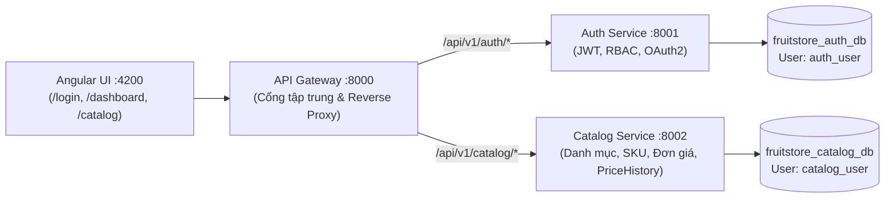

# FruitStore Management System — Hệ Thống Quản Lý Bán Lẻ & Kho Nông Sản

Hệ thống quản lý chuỗi bán lẻ trái cây tươi theo kiến trúc hướng dịch vụ (**SOA** — Service-Oriented Architecture), áp dụng nguyên tắc **Database-per-Service**, xây dựng bằng **FastAPI**, **PostgreSQL** và **Angular 21**.

---

## 1. Cấu trúc Kiến trúc Hệ thống



| Thành phần | Cổng | Đường dẫn Swagger Docs / URL | Database sở hữu |
|---|---|---|---|
| **API Gateway** | `8000` | http://localhost:8000/docs | Không dùng database |
| **Auth Service** | `8001` | http://localhost:8001/docs | `fruitstore_auth_db` |
| **Catalog Service** | `8002` | http://localhost:8002/docs | `fruitstore_catalog_db` |
| **Frontend Angular** | `4200` | http://localhost:4200 | — |

---

## 2. Hướng Dẫn Cài Đặt & Chạy Hệ Thống Từ Đầu (Từng Bước)

### Bước 1: Khởi tạo Database & DB Role (Chỉ làm 1 lần)
Mở **pgAdmin 4** (hoặc `psql` bằng tài khoản `postgres`), mở Query Tool tại database `postgres` và chạy file:
👉 [`docs/databases/00_init_all_databases.sql`](docs/databases/00_init_all_databases.sql)

Script này sẽ:
1. Tạo 2 role riêng biệt: `auth_user` (mật khẩu `CHANGE_ME_auth`) và `catalog_user` (mật khẩu `CHANGE_ME_catalog`).
2. Tạo các database độc lập: `fruitstore_auth_db`, `fruitstore_catalog_db`, v.v.
3. Thu hồi quyền kết nối từ `PUBLIC` để cô lập dữ liệu hoàn toàn giữa các service (`NFR-S08`).

Sau đó, mở Query Tool tại từng database để bật extension UUID và phân quyền schema:
- Tại **`fruitstore_auth_db`**:
  ```sql
  CREATE EXTENSION IF NOT EXISTS "pgcrypto";
  GRANT ALL ON SCHEMA public TO auth_user;
  GRANT ALL PRIVILEGES ON ALL TABLES IN SCHEMA public TO auth_user;
  GRANT ALL PRIVILEGES ON ALL SEQUENCES IN SCHEMA public TO auth_user;
  ALTER DEFAULT PRIVILEGES IN SCHEMA public GRANT ALL ON TABLES TO auth_user;
  ALTER DEFAULT PRIVILEGES IN SCHEMA public GRANT ALL ON SEQUENCES TO auth_user;
  ```
- Tại **`fruitstore_catalog_db`**:
  ```sql
  CREATE EXTENSION IF NOT EXISTS "pgcrypto";
  GRANT ALL ON SCHEMA public TO catalog_user;
  GRANT ALL PRIVILEGES ON ALL TABLES IN SCHEMA public TO catalog_user;
  GRANT ALL PRIVILEGES ON ALL SEQUENCES IN SCHEMA public TO catalog_user;
  ALTER DEFAULT PRIVILEGES IN SCHEMA public GRANT ALL ON TABLES TO catalog_user;
  ALTER DEFAULT PRIVILEGES IN SCHEMA public GRANT ALL ON SEQUENCES TO catalog_user;
  ```

---

### Bước 2: Chạy Migration (Alembic) & Nạp Dữ Liệu Mẫu (Seed Data)
Mở terminal (**PowerShell**) tại thư mục gốc của dự án `d:\fruit-store-management`:

```powershell
# 1. Chạy migration và nạp 5 vai trò RBAC + tài khoản mẫu cho Auth Service
cd backend\services\auth-service
..\..\.venv\Scripts\alembic.exe upgrade head
..\..\.venv\Scripts\python.exe -m app.scripts.seed

# 2. Chạy migration và nạp danh mục + sản phẩm trái cây mẫu cho Catalog Service
cd ..\catalog-service
..\..\.venv\Scripts\alembic.exe upgrade head
..\..\.venv\Scripts\python.exe -m app.scripts.seed

# 3. Quay lại thư mục gốc
cd ..\..\..
```

---

### Bước 3: Khởi Động Toàn Bộ Ứng Dụng

Chỉ cần chạy một file kịch bản duy nhất tại thư mục gốc:

```powershell
.\run_all.bat
```
*(Hoặc nhấp đúp chuột vào file `run_all.bat` trong File Explorer).*

Lệnh sẽ tự động mở **4 cửa sổ terminal riêng biệt**:
1. **Auth Service** (:8001)
2. **Catalog Service** (:8002)
3. **API Gateway** (:8000)
4. **Angular Frontend** (:4200)

> Nếu bạn chỉ muốn chạy riêng Backend (không mở Frontend), hãy chạy `.\run_backend.bat`.

---

## 3. Tài Khoản Mẫu Đăng Nhập Hệ Thống

| Vai trò (Role) | Email | Mật khẩu | Phạm vi quyền hạn |
|---|---|---|---|
| **Quản trị viên (ADMIN)** | `admin@fruitstore.com` | `admin123` *(hoặc `Admin@123`)* | Toàn quyền cấu hình hệ thống & nhân sự |
| **Quản lý (MANAGER)** | `manager@fruitstore.com` | `Manager@123` | Quản lý sản phẩm, danh mục, đổi giá & kho |
| **Thu ngân (STAFF)** | `staff@fruitstore.com` | `Staff@123` | Bán hàng tại quầy POS, xem danh sách sản phẩm |
| **Thủ kho (WAREHOUSE)** | `warehouse@fruitstore.com` | `Warehouse@123` | Quản lý nhập hàng theo lô & xử lý hàng hỏng |

---

## 4. Chạy Kiểm Thử Tự Động (Automated Tests)

Chạy bộ test cô lập và test tích hợp End-to-End xuyên qua Gateway:

```powershell
# Unit & API Test Auth Service (Kiểm tra JWT, RBAC, OAuth2, Alembic rollback)
d:\fruit-store-management\backend\.venv\Scripts\pytest.exe -c backend\services\auth-service\pytest.ini backend\services\auth-service\tests\test_auth_api.py -q

# Unit & API Test Catalog Service (Kiểm tra PriceHistory, SELECT FOR UPDATE, SKU, Alembic)
d:\fruit-store-management\backend\.venv\Scripts\pytest.exe -c backend\services\catalog-service\pytest.ini backend\services\catalog-service\tests\test_catalog_api.py -q

# E2E Test qua API Gateway (:8000 -> :8001 & :8002, chống giả mạo header, cô lập lỗi 502)
d:\fruit-store-management\backend\.venv\Scripts\pytest.exe -c backend\services\auth-service\pytest.ini backend\tests\e2e\test_catalog_via_gateway.py -q
```

