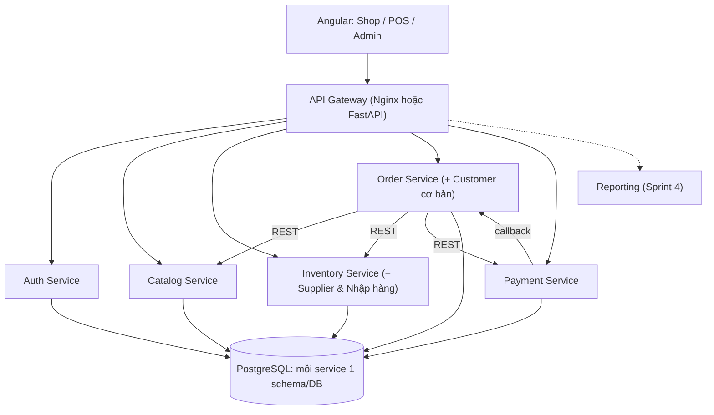

# Kế hoạch chi tiết: FruitStore Management System
**Stack:** FastAPI (Python) · Angular · PostgreSQL · Docker Compose · JWT + RBAC
**Nguồn:** phân tích từ cuộc trò chuyện ChatGPT bạn chia sẻ (kế hoạch SOA 8 tuần, 4 Sprint, kèm bàn về lưu ảnh và chatbot AI).

---

## PHẦN A. Phân tích kế hoạch gốc

### Điểm mạnh
- Đúng đặc thù trái cây: **quản lý theo lô + hạn sử dụng + FEFO**, bán theo kg (`NUMERIC`), ghi nhận hao hụt.
- Chốt phạm vi rõ: MVP (P0) → nâng cao (P1) → mở rộng.
- Có xử lý bài toán khó: **giữ hàng (reservation)**, idempotency, hoàn kho khi hủy/thanh toán lỗi.
- Có API contract, backlog, DoD, ma trận kiểm thử, kịch bản demo.

### Điểm cần điều chỉnh
| Vấn đề | Đánh giá | Đề xuất |
|---|---|---|
| 6–8 microservice + Gateway cho nhóm nhỏ | Rủi ro tiến độ cao (docker, tích hợp, debug phân tán) | Nếu là **đồ án bắt buộc SOA**: giữ 4 service lõi ở MVP. Nếu là **cửa hàng thật**: dùng *modular monolith* (1 FastAPI, mỗi module có schema riêng), tách sau. |
| Sprint 3 quá nặng (Order+Payment+Reservation+POS+Checkout) | Dễ trễ | Tách thành 2 sprint hoặc bỏ checkout online khỏi MVP, ưu tiên **POS** |
| Reporting Service riêng | Tốn công đồng bộ dữ liệu | MVP: Reporting đọc qua API/ sự kiện đơn giản, hoặc view SQL trong module |
| Thiếu: in hóa đơn, kiểm kê, trả hàng, phân quyền chi tiết, backup, audit log | Quan trọng với cửa hàng thật | Bổ sung ở Sprint 4/P1 |
| Chưa chốt thanh toán thật/vận chuyển/AI chatbot | Mở rộng | Để sau MVP |

> [!IMPORTANT]
> Cần bạn quyết định 1 điều: dự án là **đồ án SOA** (cần nhiều service độc lập) hay **phần mềm dùng thật**? Kế hoạch dưới đây mặc định **SOA gọn 5 service**, có ghi chú phương án monolith.

---

## PHẦN B. Kiến trúc đề xuất



**Nguyên tắc:** mỗi service sở hữu dữ liệu riêng; liên kết bằng ID + API (không FK chéo); response/lỗi/phân trang thống nhất; JWT được Gateway/Service verify; quyền kiểm tra ở **backend**.

| Service | Trách nhiệm | Bảng chính |
|---|---|---|
| Auth | Đăng nhập, JWT, user, role | users, roles, refresh_tokens |
| Catalog | Sản phẩm, danh mục, giá, ảnh | products, categories, product_images |
| Inventory | Lô, nhập/xuất, giữ hàng, hao hụt, NCC, phiếu nhập | stock_lots, stock_movements, reservations, suppliers, purchase_orders |
| Order | Đơn hàng, khách hàng, trạng thái | orders, order_items, customers |
| Payment | Thanh toán tiền mặt/chuyển khoản mô phỏng, hoàn tiền | payments, refunds |
| Reporting (S4) | Doanh thu, bán chạy, hao hụt | sales_summaries |

**Ảnh sản phẩm:** lưu file trong thư mục/volume (hoặc object storage), DB chỉ lưu đường dẫn (không dùng BYTEA).

### Quy tắc nghiệp vụ cốt lõi
1. Tồn khả dụng = tồn lô còn hạn − số lượng đang giữ (reservation chưa hết hạn).
2. Xuất kho theo **FEFO**; lô hết hạn không được phân bổ.
3. Mọi thay đổi tồn đều ghi `stock_movements` (IN, OUT, ADJUST, WASTE, RESERVE, RELEASE).
4. Giữ giá tại `order_items.unit_price`; backend tự lấy giá từ Catalog.
5. Reservation có TTL (vd. 15 phút) + job dọn; khóa hàng bằng `SELECT … FOR UPDATE`.
6. `Idempotency-Key` cho tạo đơn và callback thanh toán.
7. Trạng thái đơn: `PENDING_PAYMENT → PAID → COMPLETED`, nhánh `CANCELLED / EXPIRED / REFUNDED`.

---

## PHẦN C. Kế hoạch triển khai (Sprint 2 tuần)

### Sprint 0 — Chuẩn bị (3–4 ngày)
- Chốt P0 User Story, Use Case + Component Diagram, ERD, API contract (OpenAPI).
- Khóa phiên bản Python, Node, Angular, thư viện.
- Tạo monorepo, Docker Compose (postgres + services + nginx), `.env.example`, CI lint/test, quy ước Git (`main/develop/feature/*`).

### Sprint 1 — Nền tảng + Auth (tuần 1–2)
- **BE:** Auth (login, JWT access/refresh, RBAC: Admin/Manager/Staff/Warehouse/Customer), Gateway, logging có `X-Request-ID`, mẫu cấu trúc service `api → services → repositories → db`, Alembic.
- **FE:** Angular standalone, layout, login, interceptor JWT, guards, lazy routes `/shop /staff /admin`.
- **Bàn giao:** đăng nhập chạy qua Gateway; docs phân tích v1.

### Sprint 2 — Catalog + Kho (tuần 3–4)
- **BE:** CRUD sản phẩm/danh mục/giá/ảnh; nhà cung cấp, phiếu nhập → tạo lô; hạn dùng; điều chỉnh/hủy hàng (WASTE); endpoint `/inventory/expiring`; thuật toán FEFO.
- **FE:** quản lý sản phẩm, danh mục, nhập kho, danh sách lô, cảnh báo sắp hết hạn.
- **Test:** unit tính tồn, FEFO, hạn dùng, số lượng âm.
- **Bàn giao:** thêm xoài → nhập 100 kg → xem tồn → cảnh báo hạn.

### Sprint 3 — Bán hàng POS + Đơn hàng (tuần 5–6)
- **BE:** Order (tạo, hủy, đổi trạng thái hợp lệ), Inventory reserve/commit/release, Payment (tiền mặt, chuyển khoản mô phỏng), idempotency, timeout/retry, bù trừ kiểu Saga.
- **FE:** POS (tìm SP, nhập kg, giỏ, thanh toán, in hóa đơn), danh sách đơn.
- **Test:** 2 người mua kg cuối, hủy đơn, callback lặp, thanh toán lỗi.

### Sprint 4 — Shop online + Báo cáo + Triển khai (tuần 7–8)
- **Shop khách hàng:** danh sách/chi tiết sản phẩm, giỏ, checkout, theo dõi đơn.
- **Reporting:** doanh thu ngày/tháng, bán chạy, tồn kho, tỷ lệ hao hụt; dashboard Admin.
- Bảo mật (rate limit login, CORS, validate), audit log, backup DB.
- Integration/E2E (Playwright), seed data, README, báo cáo, slide.

### Sau MVP (P1/P2)
Mã giảm giá, kiểm kê, trả hàng, VNPay/MoMo, giao hàng, nhiều chi nhánh, chatbot AI, dự báo nhu cầu.

---

## PHẦN D. API contract (rút gọn)

| Nhóm | Endpoint |
|---|---|
| Auth | `POST /auth/login`, `POST /auth/refresh`, `GET /users/me`, CRUD `/users` (Admin) |
| Catalog | `GET/POST /products`, `GET/PATCH/DELETE /products/{id}`, `GET/POST /categories`, `POST /products/{id}/images` |
| Inventory | `GET /inventory/stocks`, `POST /inventory/receipts`, `POST /inventory/adjustments`, `GET /inventory/expiring`, `GET /inventory/movements`; nội bộ: `POST /inventory/reservations`, `/{id}/commit`, `/{id}/release` |
| Suppliers | `GET/POST /suppliers`, `POST /purchase-orders` |
| Order | `POST /orders` (Idempotency-Key), `GET /orders`, `GET /orders/{id}`, `PATCH /orders/{id}/status`, `POST /orders/{id}/cancel` |
| Payment | `POST /payments`, `POST /payments/callback`, `POST /payments/{id}/refund` |
| Report | `GET /reports/revenue`, `/top-products`, `/inventory`, `/waste` |

Chuẩn lỗi: `{ "code": "INSUFFICIENT_STOCK", "message": "...", "details": {} }`; phân trang `?page=&size=&sort=`.

---

## PHẦN E. Cấu trúc & quy ước

```text
fruitstore/
├── frontend/fruitstore-angular/src/app/{core,shared,features/{auth,shop,staff,admin}}
├── backend/
│   ├── api-gateway/
│   └── services/{auth,catalog,inventory,order,payment,reporting}-service/
│       └── app/{main.py,api,models,schemas,repositories,services,core,db} + alembic + tests
├── infrastructure/{postgres,nginx}
├── docs/{requirements,architecture,uml,api-contracts}
├── tests/integration
├── docker-compose.yml
└── .env.example
```
Công cụ: SQLAlchemy 2 + Alembic, Pydantic v2, pytest + HTTPX, Angular Material/Tailwind, Reactive Forms, Playwright, GitHub Actions.

---

## PHẦN F. Kiểm thử & nghiệm thu
- **Bắt buộc:** nhập 50 kg → +50; bán 2,5 kg → −2,5; hai khách mua kg cuối; hủy đơn → nhả hàng; callback lặp; lô hết hạn bị loại; Staff gọi API Admin → 403; Reporting lỗi vẫn bán được; đổi giá không ảnh hưởng đơn cũ.
- **DoD:** endpoint/UI đúng yêu cầu + validate + phân quyền + test + docs OpenAPI + PR review.
- **Demo:** thêm xoài 65.000đ/kg → nhập 100 kg → mua 3 kg (195.000đ) → thanh toán → tồn 97 kg → báo cáo doanh thu → mở Swagger từng service → thử hủy/thiếu hàng.

## PHẦN G. Rủi ro chính
| Rủi ro | Xử lý |
|---|---|
| Quá nhiều service | Giới hạn 5 service MVP, hoặc modular monolith |
| Bán vượt tồn | Reservation + khóa dòng + transaction |
| Sai lệch khi thanh toán | Idempotency, retry, bù trừ |
| Trễ tiến độ | Cắt P1 trước, giữ P0; tích hợp liên tục từ Sprint 1 |
| Lệch phiên bản môi trường | Khóa version + Docker |

**Bước đầu tiên:** chốt hướng (SOA đồ án hay dùng thật) → vẽ Use Case/Component → thống nhất ERD + OpenAPI → khởi tạo repo.
