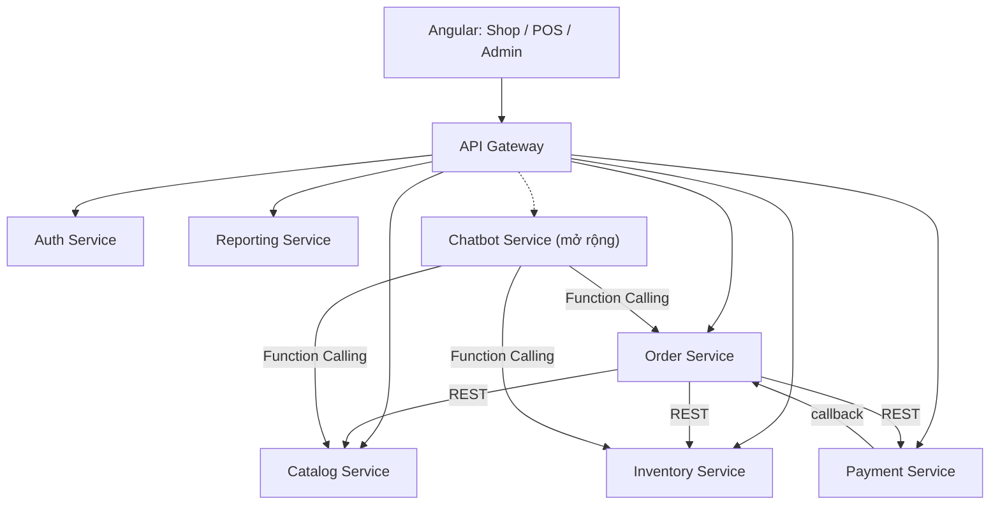
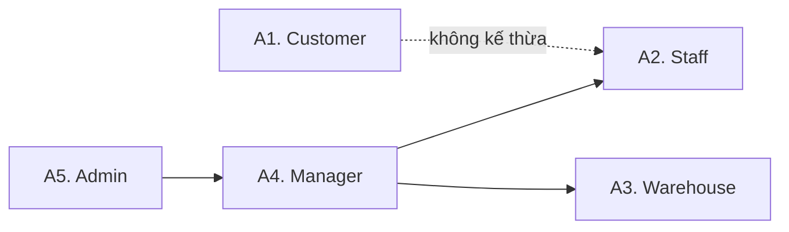
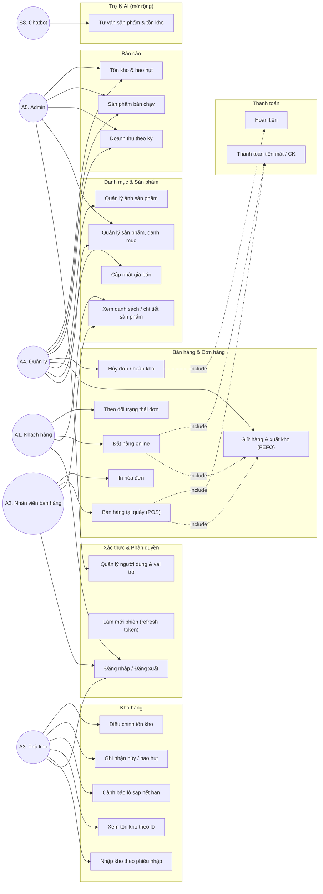

# Phân Tích Yêu Cầu — FruitStore Management System

> **Tài liệu:** Mô tả bài toán · Tác nhân · Yêu cầu chức năng · Yêu cầu phi chức năng
> **Phiên bản:** 1.0 — 26/10/2026
> **Nguồn tổng hợp:** [ke_hoach_fruitstore.md](./ke_hoach_fruitstore.md), [ke_hoach_database_soa.md](./ke_hoach_database_soa.md), [UI_UX_DESIGN_RULES_FruitStore.md](./UI_UX_DESIGN_RULES_FruitStore.md), [docs/databases/](./docs/databases/README.md)
> **Stack:** FastAPI (Python) · Angular · PostgreSQL 16 · Docker Compose · JWT + RBAC · Kiến trúc SOA (database-per-service)

---

## MỤC LỤC

1. [Tổng quan dự án](#1-tổng-quan-dự-án)
2. [Mô tả bài toán](#2-mô-tả-bài-toán)
3. [Mục tiêu và phạm vi](#3-mục-tiêu-và-phạm-vi)
4. [Tác nhân (Actors)](#4-tác-nhân-actors)
5. [Sơ đồ Use Case tổng quát](#5-sơ-đồ-use-case-tổng-quát)
6. [Yêu cầu chức năng](#6-yêu-cầu-chức-năng)
7. [Ma trận phân quyền](#7-ma-trận-phân-quyền)
8. [Quy tắc nghiệp vụ cốt lõi](#8-quy-tắc-nghiệp-vụ-cốt-lõi)
9. [Yêu cầu phi chức năng](#9-yêu-cầu-phi-chức-năng)
10. [Ưu tiên và lộ trình](#10-ưu-tiên-và-lộ-trình)
11. [Tiêu chí nghiệm thu](#11-tiêu-chí-nghiệm-thu)
12. [Truy vết tài liệu](#12-truy-vết-tài-liệu)

---

## 1. Tổng quan dự án

**FruitStore Management System** là hệ thống quản lý bán hàng và vận hành dành cho cửa hàng kinh doanh trái cây tươi, gồm ba khối chức năng chính:

| Khối | Đối tượng dùng | Chức năng đặc trưng |
|---|---|---|
| **Bán hàng tại quầy (POS)** | Nhân viên bán hàng | Tìm sản phẩm, cân kg, lập hóa đơn, thu tiền, in hóa đơn |
| **Quản trị cửa hàng (Admin/Back-office)** | Chủ cửa hàng, quản lý, thủ kho | Danh mục, giá, lô hàng, nhập kho, đơn hàng, báo cáo, phân quyền |
| **Cửa hàng trực tuyến (Shop online)** | Khách hàng | Xem sản phẩm, giỏ hàng, đặt hàng, theo dõi đơn |
| **Trợ lý AI (Mở rộng)** | Khách hàng | Tư vấn sản phẩm, kiểm tra tồn kho, hướng dẫn đặt hàng |

Hệ thống được xây dựng theo kiến trúc **SOA gọn 6–7 dịch vụ độc lập**, mỗi dịch vụ sở hữu **một database riêng** trên cùng một PostgreSQL instance, giao tiếp qua REST API và không dùng khóa ngoại xuyên database.

---

## 2. Mô tả bài toán

### 2.1. Bối cảnh hiện trạng

Các cửa hàng trái cây quy mô vừa và nhỏ tại Việt Nam hiện quản lý vận hành chủ yếu bằng **sổ sách giấy, Excel rời rạc hoặc phần mềm bán hàng thông thường**. Những cách làm này bộc lộ các hạn chế đặc thù của ngành hàng tươi sống:

| Vấn đề hiện tại | Hệ quả thực tế |
|---|---|
| Không quản lý hàng theo **lô và hạn sử dụng** | Trái cây hỏng tồn kho mà không phát hiện kịp; lô mới nhập bán trước lô cũ, lô cũ hỏng phải bỏ |
| Không có cơ chế **giữ hàng (reservation)** khi đặt online | Hai khách cùng mua kg cuối cùng → bán vượt tồn, giao thiếu, mất uy tín |
| Không có **sổ cái biến động kho** | Không giải thích được chênh lệch tồn thực tế và tồn hệ thống; không ai chịu trách nhiệm được |
| Bán theo **kg lẻ** nhưng công cụ tính tiền theo đơn vị nguyên | Sai số làm tròn, nhập sai số lượng, tranh cãi tại quầy |
| Giá thay đổi theo mùa, theo đợt nhập | Hóa đơn cũ bị sai lệch khi tra cứu lại; không có lịch sử giá |
| Không thống kê được **doanh thu, hao hụt, lợi nhuận gộp** | Không biết mặt hàng nào thực sự có lãi, tỷ lệ hỏng bao nhiêu |
| Dữ liệu phân tán giữa quầy và online | Trùng đơn, trùng khách, lệch tồn giữa hai kênh |
| Phân quyền sơ sài | Nhân viên có thể sửa giá, xóa đơn, xem báo cáo doanh thu |

### 2.2. Phát biểu bài toán

> Cần xây dựng một **hệ thống quản lý cửa hàng trái cây thống nhất** cho phép đồng thời:
>
> 1. **Bán hàng nhanh tại quầy** với đơn vị bán linh hoạt (kg, quả, hộp, giỏ), giá theo đơn vị và in hóa đơn tức thời.
> 2. **Quản lý kho theo lô và hạn sử dụng (FEFO)** để giảm hao hụt, cảnh báo hàng sắp hỏng, ghi nhận hàng hỏng/hết hạn có lý do và người chịu trách nhiệm.
> 3. **Bán hàng trực tuyến** với giỏ hàng, đặt hàng, thanh toán và theo dõi trạng thái đơn.
> 4. **Bảo đảm toàn vẹn tồn kho** khi nhiều người mua cùng lúc: không bán vượt tồn, không trừ kho hai lần, không giữ hàng vô hạn.
> 5. **Cung cấp báo cáo quản trị** về doanh thu, sản phẩm bán chạy, tồn kho và tỷ lệ hao hụt.
> 6. **Phân quyền chặt chẽ** theo vai trò và bảo vệ dữ liệu nhạy cảm ở tầng backend.

### 2.3. Bài toán kỹ thuật trọng tâm

Ba bài toán dưới đây là phần khó nhất và quyết định chất lượng hệ thống:

**a) Tranh chấp tồn kho (Race Condition)**
Hai giao dịch đồng thời mua cùng một kg xoài cuối cùng. Hệ thống phải bảo đảm **chỉ một giao dịch thành công**, giao dịch còn lại nhận lỗi `INSUFFICIENT_STOCK` rõ ràng.
→ Giải pháp: `reservations` + `reservation_items` gắn trực tiếp `lot_id`, khóa dòng `SELECT … FOR UPDATE`, ràng buộc `CHECK (quantity_remaining >= quantity_reserved)` ở tầng PostgreSQL.

**b) Nhất quán dữ liệu giữa các dịch vụ (Distributed Consistency)**
Đặt hàng → giữ kho → thanh toán → xuất kho là chuỗi nhiều service không có transaction chung.
→ Giải pháp: mô hình **Saga bù trừ** (thanh toán lỗi → release reservation; đơn hủy → hoàn kho bằng `stock_movements`), `Idempotency-Key` cho tạo đơn và callback thanh toán, reservation có TTL và job dọn.

**c) Bảo toàn lịch sử khi dữ liệu gốc thay đổi**
Catalog đổi tên/giá sản phẩm không được làm sai hóa đơn cũ; xóa sản phẩm không được làm mất lịch sử đơn.
→ Giải pháp: **snapshot** `product_name_snapshot`, `product_sku_snapshot`, `unit_price_snapshot` trong `order_items`; chỉ cho phép chuyển trạng thái `INACTIVE` thay vì xóa cứng.

### 2.4. Điểm khác biệt so với phần mềm bán hàng thông thường

| Đặc thù trái cây | Yêu cầu kỹ thuật tương ứng |
|---|---|
| Hàng tươi, hạn dùng ngắn | `stock_lots` với `expiry_date`, `shelf_life_days`, cảnh báo `NEAR_EXPIRY` |
| Bán lẻ theo gram | `NUMERIC(10,3)` cho khối lượng, hiển thị `2,5 kg` |
| Giá biến động theo mùa/đợt nhập | `price_history`, giá vốn `unit_cost` theo từng lô, giá snapshot trên đơn |
| Hao hụt tự nhiên cao | Báo cáo `wastage_summary`, phân loại `WASTE_EXPIRED` / `WASTE_DAMAGED` |
| Nhiều nguồn gốc, vùng trồng | Trường `origin`, `storage_condition` (NORMAL / COLD_2_8C) trong Catalog |
| Tồn kho không đồng nhất giữa các lô | Tồn khả dụng tính theo lô, FEFO khi phân bổ |

---

## 3. Mục tiêu và phạm vi

### 3.1. Mục tiêu

| Mã | Mục tiêu | Thước đo |
|---|---|---|
| G1 | Số hóa toàn bộ quy trình bán hàng tại quầy | Một hóa đơn hoàn tất trong ≤ 60 giây thao tác |
| G2 | Kiểm soát tồn kho theo lô và hạn dùng | 100% lần xuất kho tuân thủ FEFO; 0 trường hợp tồn âm |
| G3 | Giảm hao hụt hàng hỏng | Cảnh báo trước ≥ 3 ngày; báo cáo tỷ lệ hao hụt theo ngày |
| G4 | Bán hàng đa kênh trên một nguồn tồn duy nhất | POS và Online dùng chung Inventory, không lệch tồn |
| G5 | Minh bạch tài chính | 100% giao dịch có payment record; hoàn tiền có vết |
| G6 | Bảo mật và phân quyền | Kiểm tra quyền tại backend cho mọi endpoint; 403 khi vượt quyền |
| G7 | Chứng minh năng lực kiến trúc SOA | Mỗi service có DB riêng, migration riêng, không truy vấn chéo |

### 3.2. Phạm vi

**Trong phạm vi MVP (P0):**
- Đăng nhập, JWT access/refresh, RBAC 5 vai trò.
- Quản lý danh mục, sản phẩm, giá, ảnh sản phẩm.
- Quản lý nhà cung cấp, phiếu nhập kho, lô hàng, hạn sử dụng.
- Tồn kho theo sản phẩm và theo lô, điều chỉnh/hủy hàng có lý do.
- POS: tạo đơn, giữ hàng, thanh toán tiền mặt/chuyển khoản mô phỏng, in hóa đơn.
- Đơn hàng online: giỏ hàng, checkout, theo dõi trạng thái.
- Thanh toán, hoàn tiền, callback mô phỏng, idempotency.
- Báo cáo doanh thu, sản phẩm bán chạy, tồn kho, hao hụt.
- Audit log, backup dữ liệu.

**Ngoài phạm vi MVP (P1/P2):**
- Mã giảm giá, khách hàng thân thiết nâng cao, kiểm kê định kỳ, trả hàng.
- Tích hợp thanh toán thật (VNPay, MoMo), đơn vị vận chuyển.
- Nhiều chi nhánh, dự báo nhu cầu, chatbot AI tư vấn.
- Ứng dụng di động native.

> **Ghi chú:** Dự án ưu tiên **POS trước, online sau**. Checkout online có thể bị cắt khỏi MVP nếu tiến độ Sprint 3 chậm, nhưng dữ liệu và API phải được thiết kế sẵn để bổ sung mà không phải migrate lại.

---

## 4. Tác nhân (Actors)

### 4.1. Tác nhân con người

| Mã | Tác nhân | Mô tả | Mục tiêu chính |
|---|---|---|---|
| **A1** | **Khách hàng (Customer)** | Người mua hàng trên kênh online hoặc khách lẻ tại quầy. Có thể đăng nhập hoặc mua với tư cách khách vãng lai. | Tìm đúng sản phẩm, biết giá và tình trạng còn hàng, đặt hàng nhanh, theo dõi đơn |
| **A2** | **Nhân viên bán hàng (Staff)** | Nhân viên đứng quầy, vận hành POS, tạo đơn, thu tiền, in hóa đơn. | Bán hàng nhanh, chính xác, ít thao tác |
| **A3** | **Thủ kho (Warehouse)** | Nhân viên quản lý kho: nhập hàng, kiểm tra lô, ghi nhận hao hụt, điều chỉnh tồn. | Tồn kho khớp thực tế, hàng sắp hỏng được xử lý kịp thời |
| **A4** | **Quản lý cửa hàng (Manager)** | Quản lý vận hành: sản phẩm, giá, nhà cung cấp, đơn hàng, xem báo cáo, giám sát nhân viên. | Kiểm soát kinh doanh, ra quyết định dựa trên số liệu |
| **A5** | **Quản trị viên (Admin)** | Chủ hệ thống: quản lý người dùng, vai trò, cấu hình, toàn quyền. | Hệ thống vận hành đúng, an toàn, phân quyền hợp lý |

### 4.2. Tác nhân hệ thống (System Actors)

| Mã | Tác nhân | Vai trò trong hệ thống |
|---|---|---|
| **S1** | **API Gateway** | Điểm vào duy nhất, định tuyến request, xác thực JWT, gắn `X-Request-ID`, rate limit |
| **S2** | **Auth Service** | Phát hành/ thu hồi token, quản lý người dùng và vai trò |
| **S3** | **Catalog Service** | Nguồn sự thật về sản phẩm, giá, đơn vị tính, trạng thái kinh doanh |
| **S4** | **Inventory Service** | Nguồn sự thật về tồn kho, lô, reservation, biến động kho |
| **S5** | **Order Service** | Nguồn sự thật về đơn hàng, khách hàng, trạng thái đơn |
| **S6** | **Payment Service** | Xử lý giao dịch, callback, hoàn tiền |
| **S7** | **Reporting Service** | Đồng bộ read model, tổng hợp báo cáo |
| **S8** | **Chatbot Service** | Gọi REST API của service khác qua Function Calling, không đọc DB trực tiếp (mở rộng) |
| **S9** | **Scheduler / Background Job** | Job dọn reservation hết hạn, job cảnh báo lô sắp hết hạn, job đồng bộ báo cáo |

### 4.3. Quan hệ kế thừa giữa tác nhân

- `Manager` và `Admin` kế thừa toàn bộ quyền của `Staff` và `Warehouse` (theo mô hình phân quyền cộng dồn).
- `Admin` có thêm quyền quản lý người dùng và cấu hình hệ thống mà `Manager` không có.
- `Customer` là tác nhân độc lập, **không** thuộc nhánh nhân sự nội bộ.

---

## 5. Sơ đồ Use Case tổng quát

---

## 6. Yêu cầu chức năng

Ký hiệu ưu tiên: **P0** = bắt buộc trong MVP · **P1** = nên có · **P2** = mở rộng.

### 6.1. Nhóm FR-A — Xác thực và phân quyền (Auth Service)

| Mã | Chức năng | Tác nhân | Ưu tiên | Mô tả |
|---|---|---|---|---|
| FR-A01 | Đăng nhập bằng email/mật khẩu | A1–A5 | P0 | Trả về access token (ngắn hạn) + refresh token (lưu hash SHA-256 trong DB). Sai thông tin trả lỗi chung, không tiết lộ email tồn tại hay không. |
| FR-A02 | Làm mới phiên | A1–A5 | P0 | `POST /auth/refresh` cấp access token mới; refresh token hết hạn/bị thu hồi phải bị từ chối |
| FR-A03 | Đăng xuất | A1–A5 | P0 | Thu hồi refresh token hiện tại (`is_revoked = TRUE`) |
| FR-A04 | Xem hồ sơ cá nhân | A1–A5 | P0 | `GET /users/me` trả thông tin người dùng và danh sách vai trò |
| FR-A05 | Quản lý người dùng | A5 | P0 | Tạo, cập nhật, khóa/mở khóa tài khoản; không xóa cứng người dùng đã phát sinh giao dịch |
| FR-A06 | Gán vai trò | A5 | P0 | Gán/thu hồi vai trò trong 5 vai trò chuẩn; một người có thể có nhiều vai trò |
| FR-A07 | Khóa tài khoản tạm thời | Hệ thống | P1 | Khóa sau N lần đăng nhập sai trong khoảng thời gian cấu hình |
| FR-A08 | Đổi mật khẩu | A1–A5 | P1 | Yêu cầu mật khẩu cũ, thu hồi toàn bộ refresh token sau khi đổi |
| FR-A09 | Đăng ký tài khoản khách hàng | A1 | P1 | Tạo tài khoản vai trò `CUSTOMER`, xác thực định dạng email/số điện thoại |
| FR-A10 | Đặt lại mật khẩu qua email | A1 | P2 | Token đặt lại có thời hạn một lần |

### 6.2. Nhóm FR-B — Danh mục và sản phẩm (Catalog Service)

| Mã | Chức năng | Tác nhân | Ưu tiên | Mô tả |
|---|---|---|---|---|
| FR-B01 | Xem danh sách sản phẩm | Tất cả | P0 | Hỗ trợ tìm kiếm, lọc danh mục, khoảng giá, trạng thái, phân trang, sắp xếp |
| FR-B02 | Xem chi tiết sản phẩm | A1, A2, A4 | P0 | Hiển thị tên, SKU, đơn vị, giá, nguồn gốc, mô tả, điều kiện bảo quản, ảnh, trạng thái |
| FR-B03 | Quản lý danh mục | A4, A5 | P0 | CRUD danh mục trái cây, slug duy nhất, bật/tắt trạng thái |
| FR-B04 | Tạo/cập nhật sản phẩm | A4, A5 | P0 | SKU và slug duy nhất; đơn vị bán thuộc `kg / quả / hộp / giỏ`; giá ≥ 0 |
| FR-B05 | Ngừng kinh doanh sản phẩm | A4, A5 | P0 | Chuyển `status = INACTIVE`; sản phẩm ngừng bán không xuất hiện trong đơn mới nhưng vẫn tra cứu được trong đơn cũ |
| FR-B06 | Cập nhật giá bán | A4, A5 | P0 | Ghi `price_history` (giá cũ → giá mới, người đổi, thời điểm hiệu lực); không làm thay đổi đơn đã tạo |
| FR-B07 | Quản lý ảnh sản phẩm | A4, A5 | P0 | Upload/xóa/đổi thứ tự; tối đa **một** ảnh `is_primary` mỗi sản phẩm; chỉ lưu đường dẫn, không lưu binary |
| FR-B08 | Thiết lập hạn dùng gợi ý | A4, A5 | P0 | `shelf_life_days` và `storage_condition` dùng khi tạo lô nhập kho |
| FR-B09 | Đánh dấu trái cây trái mùa | A4 | P1 | `status = OUT_OF_SEASON` để ẩn khỏi shop nhưng vẫn giữ lịch sử |
| FR-B10 | Nhập/xuất danh mục hàng loạt | A5 | P2 | Import CSV/Excel có kiểm tra trùng SKU |

### 6.3. Nhóm FR-C — Kho hàng (Inventory Service)

| Mã | Chức năng | Tác nhân | Ưu tiên | Mô tả |
|---|---|---|---|---|
| FR-C01 | Quản lý nhà cung cấp | A3, A4 | P0 | CRUD nhà cung cấp, mã `NCC-xxx` duy nhất, bật/tắt hoạt động |
| FR-C02 | Tạo phiếu nhập kho | A3, A4 | P0 | Chọn nhà cung cấp, nhiều dòng hàng, số lượng đặt/nhận, giá vốn; trạng thái `DRAFT → RECEIVED / CANCELLED` |
| FR-C03 | Nhận hàng và sinh lô | A3 | P0 | Khi phiếu chuyển `RECEIVED`, tự sinh `stock_lots` với `lot_code`, `received_date`, `expiry_date`, `unit_cost` |
| FR-C04 | Xem tồn kho theo sản phẩm | A2, A3, A4 | P0 | Tổng khả dụng = tổng `(quantity_remaining − quantity_reserved)` của các lô còn hạn |
| FR-C05 | Xem tồn kho theo lô | A3, A4 | P0 | Mã lô, ngày nhập, hạn dùng, số lượng nhận/còn/đang giữ, giá vốn, trạng thái |
| FR-C06 | Cảnh báo lô sắp hết hạn | A3, A4 | P0 | `GET /inventory/expiring?days=N`; trạng thái `NEAR_EXPIRY` khi còn ≤ N ngày (N cấu hình, mặc định 3) |
| FR-C07 | Ghi nhận hàng hỏng / hết hạn | A3, A4 | P0 | Tạo `stock_movements` loại `WASTE_EXPIRED` / `WASTE_DAMAGED`, bắt buộc lý do, giảm tồn đúng lô |
| FR-C08 | Điều chỉnh tồn kho | A3, A4 | P0 | `ADJUSTMENT` kèm lý do; không cho sửa trực tiếp số lượng tồn mà không có bản ghi biến động |
| FR-C09 | Xem sổ cái biến động kho | A3, A4 | P0 | Lọc theo lô, sản phẩm, loại biến động, khoảng thời gian, người thực hiện |
| FR-C10 | Giữ hàng khi tạo đơn (nội bộ) | Order Service | P0 | `POST /inventory/reservations` phân bổ theo FEFO, khóa dòng, TTL 15 phút, `idempotency_key` duy nhất |
| FR-C11 | Chốt giữ hàng (commit) | Order Service | P0 | Chuyển reservation sang `COMMITTED`, sinh `SALE_OUT`, giảm `quantity_remaining` và `quantity_reserved` |
| FR-C12 | Giải phóng giữ hàng (release) | Order Service | P0 | Trả hàng về khả dụng khi hủy đơn/thanh toán lỗi/hết TTL |
| FR-C13 | Job dọn reservation hết hạn | S9 | P0 | Định kỳ chuyển `ACTIVE` quá `expires_at` sang `EXPIRED` và giải phóng |
| FR-C14 | Kiểm kê định kỳ | A3, A4 | P1 | Tạo phiếu kiểm kê, ghi nhận chênh lệch thành `ADJUSTMENT` có lý do |
| FR-C15 | Cảnh báo tồn kho thấp | A4 | P1 | Ngưỡng tối thiểu theo sản phẩm, hiển thị trên dashboard |
| FR-C16 | Quản lý nhiều kho/chi nhánh | A4 | P2 | Tách tồn theo `location_id` |

### 6.4. Nhóm FR-D — Đơn hàng và bán hàng (Order Service)

| Mã | Chức năng | Tác nhân | Ưu tiên | Mô tả |
|---|---|---|---|---|
| FR-D01 | Tạo đơn tại quầy (POS) | A2 | P0 | Chọn sản phẩm, nhập khối lượng thập phân, áp giá hiện hành từ Catalog, tính thành tiền theo dòng |
| FR-D02 | Tạo đơn online | A1 | P0 | Giỏ hàng → checkout → đơn `PENDING_PAYMENT`; bắt buộc `Idempotency-Key` để chống bấm đúp |
| FR-D03 | Giữ hàng khi tạo đơn | Hệ thống | P0 | Gọi Inventory reserve; nếu thiếu hàng trả `INSUFFICIENT_STOCK` kèm chi tiết sản phẩm thiếu, **không** tạo đơn |
| FR-D04 | Quản lý khách hàng | A2, A4 | P0 | Hồ sơ khách, số điện thoại duy nhất, địa chỉ giao hàng; hỗ trợ khách vãng lai (`customer_id` null) |
| FR-D05 | Xem danh sách đơn hàng | A2, A4, A1 | P0 | Khách chỉ thấy đơn của mình; nhân viên/quản lý thấy theo phạm vi quyền; lọc theo kênh, trạng thái, ngày |
| FR-D06 | Xem chi tiết đơn | A1, A2, A4 | P0 | Dòng hàng có snapshot tên/SKU/đơn vị/đơn giá tại thời điểm mua |
| FR-D07 | Chuyển trạng thái đơn | A2, A4 | P0 | Chỉ cho phép chuyển trạng thái hợp lệ: `PENDING_PAYMENT → PAID → PROCESSING → COMPLETED`, nhánh `CANCELLED / EXPIRED / REFUNDED` |
| FR-D08 | Hủy đơn | A1 (đơn chưa thanh toán), A2, A4 | P0 | Giải phóng reservation, hoàn kho nếu đã xuất, ghi `order_status_history` kèm lý do và người thực hiện |
| FR-D09 | Hết hạn đơn chưa thanh toán | S9 | P0 | Tự chuyển `EXPIRED` và giải phóng giữ hàng khi quá TTL |
| FR-D10 | In hóa đơn | A2 | P0 | In từ POS với mã đơn, thời gian, dòng hàng, tổng tiền, phương thức thanh toán |
| FR-D11 | Lịch sử trạng thái đơn | A2, A4 | P0 | Ghi mọi thay đổi trạng thái kèm ghi chú, người thay đổi, thời điểm |
| FR-D12 | Áp mã giảm giá | A1, A2 | P1 | Kiểm tra hạn dùng, điều kiện, số lần sử dụng; lưu `discount_amount` trên đơn |
| FR-D13 | Trả hàng / đổi hàng | A2, A4 | P1 | Tạo đơn trả, nhập lại kho theo lô gốc nếu còn dùng được |
| FR-D14 | Giao hàng và phí vận chuyển | A1, A4 | P2 | Tích hợp đơn vị vận chuyển, trạng thái giao hàng riêng |

### 6.5. Nhóm FR-E — Thanh toán (Payment Service)

| Mã | Chức năng | Tác nhân | Ưu tiên | Mô tả |
|---|---|---|---|---|
| FR-E01 | Tạo giao dịch thanh toán | A2, A1 | P0 | Phương thức `CASH`, `BANK_TRANSFER_QR`, `VNPAY_MOCK`, `MOMO_MOCK`; bắt buộc `idempotency_key` |
| FR-E02 | Xác nhận thanh toán thành công | Hệ thống | P0 | Ghi `PAID`, phát sự kiện/callback sang Order để chuyển đơn sang `PAID` và commit giữ hàng |
| FR-E03 | Xử lý callback lặp | Hệ thống | P0 | Cùng `idempotency_key`/`provider_transaction_id` trả về kết quả cũ, không tạo giao dịch mới |
| FR-E04 | Ghi nhận thanh toán thất bại | Hệ thống | P0 | Ghi `FAILED`, thông báo Order giải phóng giữ hàng |
| FR-E05 | Hoàn tiền | A4, A5 | P0 | Tạo `refunds` với số tiền ≤ số đã thu, lý do bắt buộc; cập nhật `payments.status = REFUNDED` khi hoàn toàn phần |
| FR-E06 | Nhật ký sự kiện thanh toán | Hệ thống | P0 | `payment_events` lưu `INITIATED / WEBHOOK_RECEIVED / CONFIRMED / FAILED` kèm payload JSONB |
| FR-E07 | Đối soát thanh toán | A4, A5 | P1 | Báo cáo chênh lệch giữa đơn `PAID` và giao dịch `SUCCEEDED` |
| FR-E08 | Tích hợp cổng thanh toán thật | A1 | P2 | VNPay/MoMo production, webhook có chữ ký |

### 6.6. Nhóm FR-F — Báo cáo và dashboard (Reporting Service)

| Mã | Chức năng | Tác nhân | Ưu tiên | Mô tả |
|---|---|---|---|---|
| FR-F01 | Báo cáo doanh thu theo ngày/tháng | A4, A5 | P0 | Tổng đơn, số đơn POS/online, doanh thu gộp, giảm giá, doanh thu thuần |
| FR-F02 | Báo cáo sản phẩm bán chạy | A4, A5 | P0 | Số lượng bán theo đơn vị, doanh thu, giá vốn ước tính, lợi nhuận gộp |
| FR-F03 | Báo cáo tồn kho | A3, A4 | P0 | Tồn theo sản phẩm/lô, giá trị tồn theo giá vốn, danh sách sắp hết hạn |
| FR-F04 | Báo cáo hao hụt | A4, A5 | P0 | Số lượng hỏng/hết hạn và chi phí thiệt hại theo ngày và sản phẩm |
| FR-F05 | Dashboard tổng quan | A4, A5 | P0 | KPI doanh thu, số đơn, giá trị đơn trung bình, top sản phẩm, lô sắp hết hạn, tồn thấp |
| FR-F06 | Đồng bộ read model | S9 | P0 | Job/endpoint tổng hợp từ Order và Inventory; `sync_checkpoints` theo dõi tiến độ |
| FR-F07 | Xuất báo cáo Excel/CSV | A4, A5 | P1 | Xuất theo bộ lọc hiện tại |
| FR-F08 | Báo cáo lợi nhuận theo lô | A4 | P1 | So sánh giá bán với `unit_cost` thực tế của lô đã bán |
| FR-F09 | Dự báo nhu cầu | A4 | P2 | Gợi ý lượng nhập dựa trên lịch sử bán và mùa vụ |

**Nguyên tắc báo cáo:** Reporting là **read model** — không phải nguồn sự thật. Khi Reporting lỗi hoặc tắt, POS và đặt hàng **vẫn phải hoạt động bình thường**. Dashboard phải hiển thị rõ kỳ báo cáo, đơn vị và trạng thái "chưa có dữ liệu" thay vì bịa số.

### 6.7. Nhóm FR-G — Trợ lý AI (Chatbot Service, mở rộng)

| Mã | Chức năng | Tác nhân | Ưu tiên | Mô tả |
|---|---|---|---|---|
| FR-G01 | Tư vấn sản phẩm | A1 | P2 | Trả lời về loại trái cây, nguồn gốc, cách bảo quản dựa trên Catalog qua Function Calling |
| FR-G02 | Kiểm tra tồn kho | A1 | P2 | Gọi `check_stock()` sang Inventory; **không** đọc trực tiếp DB Inventory |
| FR-G03 | Hướng dẫn đặt hàng | A1 | P2 | Giải thích quy trình, phí, trạng thái đơn của chính người dùng |
| FR-G04 | Lưu lịch sử hội thoại | Hệ thống | P2 | `conversations`/`messages`; hỗ trợ cả khách vãng lai qua `session_id` |
| FR-G05 | Ghi log gọi công cụ | Hệ thống | P2 | `tool_execution_logs` lưu `tool_name`, `arguments`, `response_summary`, `duration_ms`, `status` |
| FR-G06 | Thu thập đánh giá phản hồi | A1 | P2 | `chat_feedback` với `rating` 1 / −1 và bình luận |

### 6.8. Nhóm FR-H — Vận hành hệ thống

| Mã | Chức năng | Tác nhân | Ưu tiên | Mô tả |
|---|---|---|---|---|
| FR-H01 | Audit log | Hệ thống | P0 | Ghi lại thao tác nhạy cảm: đổi giá, hủy đơn, điều chỉnh tồn, hoàn tiền, đổi quyền |
| FR-H02 | Health check từng service | S9/DevOps | P0 | `GET /health` trả trạng thái service và kết nối DB |
| FR-H03 | Seed dữ liệu mẫu | DevOps | P0 | 5 role, 1 admin, danh mục + 10 sản phẩm, 3 nhà cung cấp, 15 lô (còn hạn / sắp hết hạn / hết hạn) |
| FR-H04 | Sao lưu và phục hồi DB | DevOps | P0 | Script backup định kỳ, quy trình restore được kiểm thử |
| FR-H05 | Cấu hình hệ thống | A5 | P1 | Ngưỡng cảnh báo hạn dùng, TTL reservation, thời gian khóa đăng nhập |

---

## 7. Ma trận phân quyền

Ký hiệu: **✔** toàn quyền · **◐** quyền hạn chế (chỉ dữ liệu của mình / chỉ đọc) · **–** không có quyền.

| Chức năng | Customer | Staff | Warehouse | Manager | Admin |
|---|:--:|:--:|:--:|:--:|:--:|
| Đăng nhập / xem hồ sơ cá nhân | ✔ | ✔ | ✔ | ✔ | ✔ |
| Quản lý người dùng & vai trò | – | – | – | – | ✔ |
| Xem sản phẩm | ✔ | ✔ | ✔ | ✔ | ✔ |
| Tạo/sửa/xóa sản phẩm, danh mục | – | – | – | ✔ | ✔ |
| Cập nhật giá bán | – | – | – | ✔ | ✔ |
| Quản lý ảnh sản phẩm | – | – | – | ✔ | ✔ |
| Xem tồn kho theo lô | – | ◐ | ✔ | ✔ | ✔ |
| Tạo phiếu nhập kho | – | – | ✔ | ✔ | ✔ |
| Ghi nhận hao hụt / điều chỉnh tồn | – | – | ✔ | ✔ | ✔ |
| Bán hàng POS | – | ✔ | – | ✔ | ✔ |
| Đặt hàng online | ✔ | – | – | – | – |
| Xem danh sách đơn hàng | ◐ | ◐ | – | ✔ | ✔ |
| Hủy đơn hàng | ◐ | ✔ | – | ✔ | ✔ |
| Thanh toán | ◐ | ✔ | – | ✔ | ✔ |
| Hoàn tiền | – | – | – | ✔ | ✔ |
| Xem báo cáo doanh thu | – | – | – | ✔ | ✔ |
| Xem báo cáo hao hụt & tồn kho | – | – | ◐ | ✔ | ✔ |
| Cấu hình hệ thống | – | – | – | – | ✔ |
| Chatbot tư vấn | ✔ | – | – | – | – |

**Quy tắc bắt buộc:** Ẩn menu/nút trên UI **không phải** biện pháp bảo mật. Mọi endpoint phải kiểm tra quyền ở backend và trả `403` khi vượt quyền, `401` khi chưa xác thực. Customer chỉ truy cập được dữ liệu gắn với `user_id` của chính mình.

---

## 8. Quy tắc nghiệp vụ cốt lõi

| Mã | Quy tắc | Cưỡng chế ở đâu |
|---|---|---|
| BR-01 | **Tồn khả dụng** của lô = `quantity_remaining − quantity_reserved`, chỉ tính lô có `expiry_date >= CURRENT_DATE` và trạng thái `AVAILABLE`/`NEAR_EXPIRY` | Inventory Service + SQL |
| BR-02 | Xuất kho theo **FEFO** — lô hết hạn sớm nhất được phân bổ trước; lô hết hạn **không bao giờ** được giữ/bán | Inventory Service (index FEFO) |
| BR-03 | Mọi thay đổi tồn kho **phải** sinh bản ghi `stock_movements` (`IN`, `SALE_OUT`, `WASTE_EXPIRED`, `WASTE_DAMAGED`, `ADJUSTMENT`) — không sửa trực tiếp số lượng | Inventory Service |
| BR-04 | Không cho tồn âm: `CHECK (quantity_remaining >= 0)` và `CHECK (quantity_remaining >= quantity_reserved)` | PostgreSQL constraint |
| BR-05 | Giữ hàng có **TTL 15 phút**; hết hạn tự giải phóng; khóa dòng bằng `SELECT … FOR UPDATE` | Inventory Service + Scheduler |
| BR-06 | Giá bán trên đơn lấy **từ Catalog tại thời điểm tạo đơn**, lưu snapshot vào `order_items.unit_price_snapshot` | Order Service |
| BR-07 | Đổi giá/tên sản phẩm **không** làm thay đổi đơn hàng lịch sử | Snapshot trong `order_items` |
| BR-08 | `Idempotency-Key` bắt buộc cho tạo đơn, reservation, thanh toán và callback thanh toán | Unique constraint + xử lý ở service |
| BR-09 | Trạng thái đơn chỉ chuyển theo đồ thị hợp lệ; mọi lần chuyển ghi `order_status_history` | Order Service |
| BR-10 | Thanh toán lỗi/hủy đơn → giải phóng giữ hàng; đã xuất kho → hoàn kho bằng `stock_movements` | Saga giữa Order/Inventory/Payment |
| BR-11 | Không xóa cứng dữ liệu đã phát sinh giao dịch (sản phẩm, khách, đơn, người dùng) — chỉ chuyển trạng thái | Tất cả service |
| BR-12 | Không tạo khóa ngoại xuyên database; tham chiếu liên dịch vụ chỉ lưu `UUID` và kiểm tra qua REST | Thiết kế CSDL |
| BR-13 | Mỗi service kết nối DB bằng role riêng; truy vấn chéo DB phải bị PostgreSQL từ chối | Script khởi tạo + `REVOKE` |
| BR-14 | Ảnh sản phẩm lưu ngoài DB (volume/object storage), DB chỉ giữ đường dẫn; tối đa 1 ảnh primary/sản phẩm | Catalog DB (partial unique index) |
| BR-15 | Số tiền dùng `NUMERIC(14,2)`; khối lượng dùng `NUMERIC(10,3)`; thời gian dùng `TIMESTAMPTZ` UTC | Quy ước CSDL toàn hệ thống |

---

## 9. Yêu cầu phi chức năng

### 9.1. Hiệu năng (Performance)

| Mã | Yêu cầu | Ngưỡng chấp nhận |
|---|---|---|
| NFR-P01 | Thời gian phản hồi API đọc thông thường (danh sách sản phẩm, tồn kho có phân trang) | p95 ≤ **300 ms** |
| NFR-P02 | Thời gian phản hồi API ghi (tạo đơn, nhập kho, thanh toán) | p95 ≤ **800 ms** |
| NFR-P03 | Thao tác POS tìm sản phẩm và thêm vào giỏ | ≤ **200 ms** phản hồi cảm nhận |
| NFR-P04 | Tải đồng thời mục tiêu | **50 request đồng thời**, 0 lỗi 5xx trong 5 phút kiểm thử |
| NFR-P05 | Trang dashboard báo cáo (30 ngày dữ liệu) | ≤ **2 giây** nhờ read model đã tổng hợp sẵn |
| NFR-P06 | Truy vấn FEFO khi tạo reservation | ≤ **150 ms** với 10.000 lô đang hoạt động (có index chuyên dụng) |

### 9.2. Bảo mật (Security)

| Mã | Yêu cầu |
|---|---|
| NFR-S01 | Xác thực bằng **JWT** (access token ngắn hạn + refresh token lưu dạng hash SHA-256, có thể thu hồi) |
| NFR-S02 | Mật khẩu băm bằng **Argon2id** hoặc **bcrypt** với cost phù hợp; không bao giờ lưu hoặc log plaintext |
| NFR-S03 | Phân quyền **RBAC** kiểm tra tại backend cho **100%** endpoint; UI ẩn/hiện chỉ là hỗ trợ |
| NFR-S04 | Rate limit cho `/auth/login` (ví dụ 5 lần/phút/IP) và cho endpoint công khai |
| NFR-S05 | Cấu hình **CORS** chỉ cho origin được khai báo; không dùng `*` ở môi trường thật |
| NFR-S06 | Validate toàn bộ input phía server bằng **Pydantic v2**; chặn SQL injection qua ORM/tham số hóa |
| NFR-S07 | Không trả chi tiết kỹ thuật (stack trace, tên bảng) trong lỗi cho client; thông báo lỗi thân thiện, có mã lỗi |
| NFR-S08 | Mỗi service dùng **DB role riêng**, `REVOKE CONNECT ... FROM PUBLIC`; không truy cập chéo database |
| NFR-S09 | Không lưu bí mật trong mã nguồn — dùng `.env`/secret, `.env.example` chỉ chứa tên biến |
| NFR-S10 | Kiểm tra quyền sở hữu dữ liệu: khách hàng chỉ đọc/ghi tài nguyên của chính mình (chống IDOR) |
| NFR-S11 | Audit log cho thao tác nhạy cảm, lưu tối thiểu 90 ngày, không cho sửa/xóa qua API |
| NFR-S12 | HTTPS khi triển khai thật; token không lưu trong URL |

### 9.3. Độ tin cậy và toàn vẹn dữ liệu (Reliability & Integrity)

| Mã | Yêu cầu |
|---|---|
| NFR-R01 | Không xảy ra **bán vượt tồn** kể cả khi có request đồng thời (kiểm thử 2 khách mua kg cuối) |
| NFR-R02 | Không tạo **đơn trùng** hoặc **trừ kho hai lần** khi client retry (idempotency) |
| NFR-R03 | Mọi thao tác nhiều bước có cơ chế **bù trừ (compensation)** khi một bước thất bại |
| NFR-R04 | Sự cố Reporting **không** chặn bán hàng hay đặt hàng |
| NFR-R05 | Tính khả dụng mục tiêu của luồng bán hàng: **≥ 99%** trong giờ mở cửa |
| NFR-R06 | Reservation hết hạn được dọn tự động, không để hàng bị giữ vĩnh viễn |
| NFR-R07 | Transaction bao trùm các thao tác ghi liên quan trong cùng một service; rollback khi lỗi |

### 9.4. Khả năng mở rộng (Scalability)

| Mã | Yêu cầu |
|---|---|
| NFR-SC01 | Mỗi service đóng gói trong container riêng, scale độc lập theo tải |
| NFR-SC02 | API không giữ trạng thái phiên ở server (stateless) để scale ngang |
| NFR-SC03 | Các service giao tiếp bất đồng bộ cho tác vụ không chặn (báo cáo, thông báo) |
| NFR-SC04 | Thiết kế sẵn cho nhiều chi nhánh (thêm `location_id`) mà không phá vỡ schema |
| NFR-SC05 | Ảnh sản phẩm chuyển từ volume sang object storage (MinIO/S3) không cần đổi hợp đồng API |

### 9.5. Khả năng bảo trì và mở rộng mã nguồn (Maintainability)

| Mã | Yêu cầu |
|---|---|
| NFR-M01 | Cấu trúc service thống nhất: `api → services → repositories → db`; tách rõ tầng |
| NFR-M02 | Mỗi service có bộ **Alembic migration độc lập**, chạy tự động khi container khởi động |
| NFR-M03 | API có tài liệu **OpenAPI/Swagger** tự sinh, mở được từng service |
| NFR-M04 | Chuẩn phản hồi lỗi thống nhất: `{ "code", "message", "details" }`; phân trang `?page=&size=&sort=` |
| NFR-M05 | Frontend Angular tổ chức theo `core / shared / features`; dùng standalone component, lazy route, interceptor JWT, guard vai trò |
| NFR-M06 | Design token tập trung cho màu, spacing, typography; không hard-code giá trị rải rác |
| NFR-M07 | Mã nguồn tuân thủ lint/format; có CI chạy lint + test cho mỗi pull request |
| NFR-M08 | Cấu hình qua biến môi trường; không hard-code URL, port, thông tin kết nối |

### 9.6. Khả năng sử dụng và trải nghiệm (Usability & UX)

| Mã | Yêu cầu |
|---|---|
| NFR-U01 | Giao diện mặc định **tiếng Việt** có dấu đầy đủ, microcopy rõ ràng, không dùng "Submit/OK" chung chung |
| NFR-U02 | POS hoàn tất một hóa đơn trong ≤ 60 giây thao tác, hỗ trợ bàn phím, hiển thị `2,5 kg` rõ ràng |
| NFR-U03 | Mọi thao tác bất đồng bộ có trạng thái **loading / success / error / empty / retry**; không báo thành công trước khi server xác nhận |
| NFR-U04 | Xác nhận trước các thao tác khó đảo ngược: xóa, hủy đơn đã xử lý, hủy hàng, điều chỉnh tồn, hoàn tiền |
| NFR-U05 | Phân biệt bằng chữ + icon, **không** chỉ dùng màu, cho các trạng thái lô, đơn và thanh toán |
| NFR-U06 | Dữ liệu demo phải được nhận diện là demo; không hiển thị số liệu bịa |
| NFR-U07 | Giữ dữ liệu form khi submit lỗi; thông báo lỗi đặt cạnh trường và nêu cách sửa |

### 9.7. Khả năng tiếp cận (Accessibility)

| Mã | Yêu cầu |
|---|---|
| NFR-A01 | Đạt mức **WCAG 2.1 AA** cho tương phản màu và kích thước chữ tối thiểu |
| NFR-A02 | Điều hướng được bằng bàn phím, `focus state` nhìn thấy rõ |
| NFR-A03 | Mọi input có `<label>` liên kết; mọi ảnh có `alt` phù hợp |
| NFR-A04 | Cấu trúc heading đúng thứ bậc, HTML semantic |
| NFR-A05 | Biểu đồ có bảng/tóm tắt văn bản thay thế |
| NFR-A06 | Vùng chạm tối thiểu **44 × 44 px** trên mobile |

### 9.8. Tương thích và responsive (Compatibility)

| Mã | Yêu cầu |
|---|---|
| NFR-C01 | Hỗ trợ phiên bản Chrome/Edge/Firefox/Safari hai bản gần nhất |
| NFR-C02 | Responsive 3 breakpoint: desktop ≥ 1200 px, tablet 768–1199 px, mobile < 768 px |
| NFR-C03 | Khách hàng mobile-first; dashboard ưu tiên desktop; POS tối ưu desktop/tablet |
| NFR-C04 | Khóa phiên bản Python, Node, Angular và thư viện; chạy được bằng `docker compose up -d` trên máy thành viên |
| NFR-C05 | Hiển thị thời gian theo `Asia/Ho_Chi_Minh`, tiền theo định dạng Việt Nam `65.000 ₫/kg` |

### 9.9. Khả năng quan sát (Observability)

| Mã | Yêu cầu |
|---|---|
| NFR-O01 | Mỗi request có `X-Request-ID` xuyên suốt Gateway → service, dùng để tra log |
| NFR-O02 | Log có cấu trúc (JSON hoặc định dạng thống nhất), không chứa mật khẩu/token/dữ liệu nhạy cảm |
| NFR-O03 | Endpoint `/health` cho từng service, dùng cho kiểm tra container |
| NFR-O04 | Ghi nhận thời lượng gọi liên service để phát hiện điểm nghẽn |
| NFR-O05 | Lỗi tích hợp (timeout, 5xx) được log kèm context đủ để tái hiện |

### 9.10. Sao lưu, phục hồi và dữ liệu (Backup & Data)

| Mã | Yêu cầu |
|---|---|
| NFR-D01 | Sao lưu PostgreSQL định kỳ (tối thiểu hằng ngày), giữ ≥ 7 bản gần nhất |
| NFR-D02 | Quy trình restore được kiểm thử ít nhất một lần trước nghiệm thu |
| NFR-D03 | Script seed + migration cho phép dựng lại môi trường từ đầu bằng một lệnh |
| NFR-D04 | Không commit dữ liệu thật hoặc file `.env` chứa bí mật lên Git |

### 9.11. Kiểm thử và chất lượng (Testing & Quality)

| Mã | Yêu cầu |
|---|---|
| NFR-Q01 | Unit test cho logic tồn kho, FEFO, tính tiền, chuyển trạng thái đơn |
| NFR-Q02 | Integration test cho luồng đặt hàng → giữ kho → thanh toán → xuất kho |
| NFR-Q03 | E2E test (Playwright) cho đăng nhập, POS, checkout |
| NFR-Q04 | 100% kịch bản bắt buộc trong mục 11 phải kiểm thử tự động hoặc có bằng chứng chạy tay |
| NFR-Q05 | Độ phủ test backend mục tiêu ≥ **70%** cho tầng service và repository |

### 9.12. Ràng buộc kỹ thuật và pháp lý

| Mã | Ràng buộc |
|---|---|
| NFR-K01 | Backend **FastAPI + SQLAlchemy 2.0 async + Alembic + Pydantic v2**; Frontend **Angular** |
| NFR-K02 | PostgreSQL 16, mỗi service một database logic trên cùng instance, user riêng |
| NFR-K03 | Triển khai bằng **Docker Compose** (postgres + services + nginx gateway) |
| NFR-K04 | Không dùng `FLOAT` cho tiền; không dùng `BYTEA` cho ảnh; không dùng `SERIAL` cho khóa chính xuyên service |
| NFR-K05 | Ngôn ngữ giao diện tiếng Việt; mã nguồn và API dùng tiếng Anh |
| NFR-K06 | Thanh toán trong MVP là **mô phỏng** — không xử lý tiền thật, không lưu thông tin thẻ |

---

## 10. Ưu tiên và lộ trình

### 10.1. Phân loại MoSCoW

| Mức | Nội dung |
|---|---|
| **Must have (P0)** | Auth + RBAC, Catalog CRUD, nhập kho theo lô, FEFO + reservation, POS, đơn online cơ bản, thanh toán mô phỏng + hoàn tiền, báo cáo doanh thu/hao hụt, audit log, seed + Docker Compose |
| **Should have (P1)** | Khóa đăng nhập, kiểm kê, mã giảm giá, trả hàng, xuất Excel, đối soát, cảnh báo tồn thấp, đăng ký khách hàng |
| **Could have (P2)** | Chatbot AI, dự báo nhu cầu, cổng thanh toán thật, giao hàng, đa chi nhánh, import hàng loạt |
| **Won't have (lần này)** | Ứng dụng mobile native, ERP kế toán đầy đủ, quản lý nhân sự/lương, sàn thương mại điện tử |

### 10.2. Ánh xạ yêu cầu vào Sprint

| Sprint | Nội dung | Yêu cầu liên quan |
|---|---|---|
| **Sprint 0** (3–4 ngày) | Chốt use case, ERD, OpenAPI; khởi tạo monorepo, Docker Compose, CI | NFR-M01, NFR-M07, NFR-K03 |
| **Sprint 1** (tuần 1–2) | Auth, RBAC, Gateway, Angular layout + login + guard | FR-A01→A06, NFR-S01→S03 |
| **Sprint 2** (tuần 3–4) | Catalog, nhà cung cấp, phiếu nhập, lô, FEFO, cảnh báo hạn | FR-B01→B08, FR-C01→C09, BR-01→BR-04 |
| **Sprint 3** (tuần 5–6) | Order, reservation, Payment, POS, idempotency, bù trừ | FR-D01→D11, FR-C10→C13, FR-E01→E06, BR-05→BR-10 |
| **Sprint 4** (tuần 7–8) | Shop online, Reporting, bảo mật, audit, backup, E2E | FR-D02, FR-F01→F06, FR-H01→H04, NFR-D01→D04 |
| **Sprint 5** (mở rộng) | Chatbot AI, P1/P2 còn lại | FR-G01→G06, FR-E08, FR-F09 |

---

## 11. Tiêu chí nghiệm thu

Các kịch bản dưới đây là **điều kiện bắt buộc** để coi hệ thống đạt yêu cầu:

| Mã | Kịch bản | Kết quả mong đợi |
|---|---|---|
| AC-01 | Nhập 50 kg xoài vào kho | Tồn khả dụng tăng đúng 50 kg, sinh 1 lô và 1 `stock_movements` loại `IN` |
| AC-02 | Bán 2,5 kg xoài tại POS | Tồn giảm 2,5 kg, hóa đơn đúng `2,5 × đơn giá` (không sai số thập phân) |
| AC-03 | Hai khách đồng thời mua kg cuối cùng | Chỉ **một** đơn thành công; đơn còn lại nhận `INSUFFICIENT_STOCK` |
| AC-04 | Hủy đơn đã giữ hàng | Reservation `RELEASED`, tồn khả dụng trở lại, lịch sử trạng thái có ghi nhận |
| AC-05 | Gửi lặp cùng `Idempotency-Key` tạo đơn | Chỉ **một** đơn được tạo, phản hồi giống nhau |
| AC-06 | Callback thanh toán gửi 2 lần | Chỉ **một** giao dịch `SUCCEEDED`, không trừ tiền/không đổi trạng thái lần hai |
| AC-07 | Tồn có lô A (còn 2 ngày) và lô B (còn 30 ngày) | FEFO phân bổ từ lô A trước |
| AC-08 | Lô đã hết hạn | Không được chọn khi tạo reservation; không hiển thị là còn bán được |
| AC-09 | Cố tình trừ kho âm bằng SQL | PostgreSQL từ chối bằng `CHECK constraint` |
| AC-10 | Staff gọi API quản lý người dùng | Trả `403`, không lộ dữ liệu |
| AC-11 | Tắt Reporting Service rồi bán hàng | POS và đặt hàng vẫn chạy bình thường |
| AC-12 | Đổi giá sản phẩm sau khi đã bán | Hóa đơn cũ giữ nguyên đơn giá snapshot |
| AC-13 | Truy vấn chéo DB bằng user service khác | PostgreSQL trả `permission denied` |
| AC-14 | Upload ảnh sản phẩm | File lưu ngoài DB, DB chỉ có đường dẫn, tối đa 1 ảnh primary |
| AC-15 | Thanh toán thất bại | Đơn không chuyển `PAID`, giữ hàng được giải phóng |
| AC-16 | Đơn chưa thanh toán quá 15 phút | Tự `EXPIRED`, hàng được nhả |
| AC-17 | Khách A xem đơn của khách B | Trả `403`/`404`, không trả dữ liệu |
| AC-18 | Hai người dùng cùng vai trò thao tác đồng thời trên cùng lô | Không mất bản ghi biến động, số liệu cuối cùng khớp |

---

## 12. Truy vết tài liệu

| Tài liệu | Nội dung liên quan |
|---|---|
| [ke_hoach_fruitstore.md](./ke_hoach_fruitstore.md) | Kiến trúc tổng thể, sprint, API contract, rủi ro, DoD |
| [ke_hoach_database_soa.md](./ke_hoach_database_soa.md) | Thiết kế database-per-service, quy ước kiểu dữ liệu, script khởi tạo, lộ trình migration |
| [docs/databases/README.md](./docs/databases/README.md) | Tổng quan 7 database, tài khoản, port, quy ước chung |
| [docs/databases/01_auth_db.md](./docs/databases/01_auth_db.md) | `users`, `roles`, `user_roles`, `refresh_tokens` |
| [docs/databases/02_catalog_db.md](./docs/databases/02_catalog_db.md) | `categories`, `products`, `product_images`, `price_history` |
| [docs/databases/03_inventory_db.md](./docs/databases/03_inventory_db.md) | `suppliers`, `purchase_orders`, `stock_lots`, `reservations`, `stock_movements` |
| [docs/databases/04_order_db.md](./docs/databases/04_order_db.md) | `customers`, `orders`, `order_items`, lịch sử trạng thái |
| [docs/databases/05_payment_db.md](./docs/databases/05_payment_db.md) | `payments`, `refunds`, `payment_events` |
| [docs/databases/06_reporting_db.md](./docs/databases/06_reporting_db.md) | Read model doanh thu, bán chạy, hao hụt |
| [docs/databases/07_chatbot_db.md](./docs/databases/07_chatbot_db.md) | Hội thoại, log gọi công cụ, đánh giá phản hồi |
| [UI_UX_DESIGN_RULES_FruitStore.md](./UI_UX_DESIGN_RULES_FruitStore.md) | Nguyên tắc UI/UX, design token, quy tắc trạng thái, accessibility |

---

*Tài liệu này là cơ sở để viết Use Case chi tiết, đặc tả OpenAPI và checklist kiểm thử. Khi có thay đổi phạm vi, cập nhật mục 3 (Phạm vi), mục 6 (Yêu cầu chức năng) và mục 11 (Tiêu chí nghiệm thu) trước, sau đó đồng bộ sang tài liệu kế hoạch và CSDL.*
